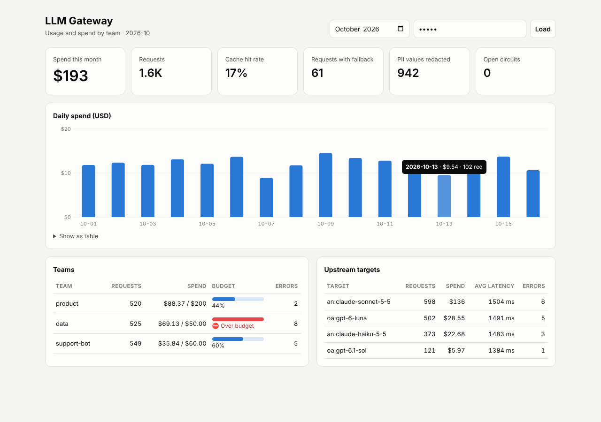
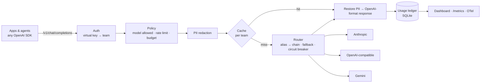

# LLM Gateway

> One OpenAI-compatible endpoint in front of Claude, GPT, Gemini and local models. It adds what a company needs before it can use AI in production: **routing with fallback, per-team keys and budgets, personal-data redaction, caching and observability.**

[](https://github.com/gabicuesta/llm-gateway/actions/workflows/ci.yml)


🇪🇸 [Versión en español más abajo](#-en-español)



## Why

When AI moves from experiments to production, a company runs into the same questions every time:

- **Who is spending what?** Without per-team keys and budgets, the AI bill is a surprise at the end of the month.
- **What happens when a provider fails?** Outages and rate limits happen, and each team ends up writing its own retries.
- **Is customer data leaving the company?** DNIs, emails and IBANs end up in prompts.
- **Which model should we use?** Hard-coding vendor SDKs into every service makes switching models a project.

A gateway answers all four in one place, without changing application code: any OpenAI SDK works by changing `base_url`.

```python
from openai import OpenAI

client = OpenAI(base_url="http://localhost:8080/v1", api_key="gw-...")  # a team's virtual key
client.chat.completions.create(model="balanced", messages=[{"role": "user", "content": "Hola"}])
```

## Features

| | |
|---|---|
| **Routing & fallback** | Clients ask for aliases (`smart`, `balanced`, `fast`). Each alias maps to an ordered chain across providers. Network errors, timeouts, 429 and 5xx fall through to the next target. A per-target **circuit breaker** skips a failing provider for a cooldown period. Streams fall back too, as long as no token has been sent yet. |
| **Providers** | Anthropic, Gemini, and anything OpenAI-compatible (OpenAI, vLLM, Ollama, OpenRouter…). Text, images and streaming are translated both ways. |
| **Teams** | Virtual API keys (only sha256 hashes are stored), allowed models per team, **monthly budgets in USD** enforced on real spend, and requests-per-minute limits. |
| **PII redaction** | Spanish DNI/NIE, emails, phone numbers, IBANs and card numbers are replaced with placeholders (`[DNI_1]`) before the request leaves. The originals are **put back in the response**, including in streams where a placeholder is split across chunks. Checksums are validated (DNI letter, IBAN mod-97, Luhn) to avoid false positives. There is also a `block` mode. |
| **Cache** | Exact-match cache for deterministic requests. Keys are built from the *redacted* request and **scoped per team**. |
| **Observability** | SQLite usage ledger, `/admin/usage` JSON, a **dashboard**, Prometheus `/metrics` and optional **OpenTelemetry** traces using the GenAI semantic conventions. Every response carries `x-gateway-*` headers: target, fallbacks, cost, cache status, PII count and remaining budget. |

## Architecture



## Quick start

```bash
git clone https://github.com/gabicuesta/llm-gateway && cd llm-gateway
uv venv && uv pip install -e ".[dev]"
cp .env.example .env                 # provider API keys
cp config.example.yaml config.yaml   # aliases, teams, budgets

llm-gateway key --team product       # prints a key for the team + the hash for config.yaml
llm-gateway key --team admin         # same for the admin key (dashboard, /metrics)
llm-gateway check                    # validates config and warns about missing API keys
llm-gateway serve --port 8080
```

Then open `http://localhost:8080/dashboard` and use the admin key.

**Docker:**

```bash
docker build -t llm-gateway .
docker run -p 8080:8080 --env-file .env -v $PWD/config.yaml:/config/config.yaml -v $PWD/data:/data llm-gateway
# set `database: /data/gateway.db` in config.yaml so usage survives restarts
```

**Traces:**

```bash
pip install -e ".[otel]"
# configure the OpenTelemetry SDK, e.g. OTEL_EXPORTER_OTLP_ENDPOINT
```

## Configuration

```yaml
models:
  balanced: [anthropic:claude-sonnet-5-5, openai:gpt-6.1-sol, gemini:gemini-3.8-flash]
  fast:     [openai:gpt-6-luna, anthropic:claude-haiku-5-5]

teams:
  - name: data
    key_hashes: ["<sha256>"]
    monthly_budget_usd: 50
    requests_per_minute: 30
    allowed_models: [fast]

pii: { enabled: true, mode: mask, restore_in_response: true }
```

See [`config.example.yaml`](config.example.yaml) for every option.

## Design decisions

The full records are in [`docs/adr`](docs/adr).

1. **OpenAI's API as the lingua franca.** It is what every SDK, framework and tool already speaks, so adopting the gateway is a one-line change. ([ADR 0001](docs/adr/0001-openai-compatible-surface.md))
2. **Reversible redaction, not just masking.** The provider never sees the data, and the user still gets a useful answer. ([ADR 0002](docs/adr/0002-reversible-pii-redaction.md))
3. **Budgets on real spend, enforced before the call.** The in-memory counter updates as soon as a request finishes. SQLite is the source of truth and survives restarts. ([ADR 0003](docs/adr/0003-budgets-and-ledger.md))
4. **Fallback only where it's safe.** No retries on invalid requests (400/413/422), and no fallback mid-stream once tokens have reached the client.

## Tests

```bash
pytest   # 42 offline tests
```

The tests cover:

- Wire formats for each provider, including SSE streaming
- Fallback and the circuit breaker
- Budgets, rate limits and per-team policies
- PII detection and restoration, including split stream tokens
- Cache scoping
- Admin endpoints and metrics
- A drop-in check using the **official OpenAI SDK** against the gateway

## Limits and roadmap

v1 is a single-instance gateway. Rate limits and the cache live in memory, and the ledger is SQLite.

- [ ] Redis for rate limits and the cache, and Postgres for the ledger (horizontal scaling)
- [ ] Tool calling translated for Anthropic and Gemini (today it is OpenAI-compatible targets only)
- [ ] Embeddings and Responses API endpoints
- [ ] Semantic cache
- [ ] Prompt-injection and output-policy guardrails
- [ ] Per-alias A/B routing with eval hooks

## License

MIT.

---

## 🇪🇸 En español

**Un único endpoint compatible con OpenAI delante de Claude, GPT, Gemini y modelos locales. Añade lo que una empresa necesita para usar IA en producción: enrutado con fallback, claves y presupuestos por equipo, redacción de datos personales, caché y observabilidad.**

Cualquier SDK de OpenAI funciona cambiando solo el `base_url`.

- **Enrutado y fallback:** alias como `smart`, `balanced` o `fast`, que apuntan a cadenas de proveedores. Si uno falla, el siguiente responde. Un *circuit breaker* aparta durante un tiempo al proveedor que está dando errores.
- **Equipos:** claves virtuales, modelos permitidos, presupuesto mensual en dólares aplicado sobre el gasto real, y límite de peticiones por minuto.
- **Datos personales:** DNI/NIE, emails, teléfonos, IBAN y tarjetas se sustituyen por marcadores antes de salir hacia el proveedor y se restauran en la respuesta, también en streaming.
- **Caché y observabilidad:** caché por equipo, registro de uso en SQLite, panel, métricas Prometheus y trazas OpenTelemetry.

**Arranque rápido:** `llm-gateway key --team producto`, añade el hash a `config.yaml`, ejecuta `llm-gateway serve` y abre `/dashboard`.
